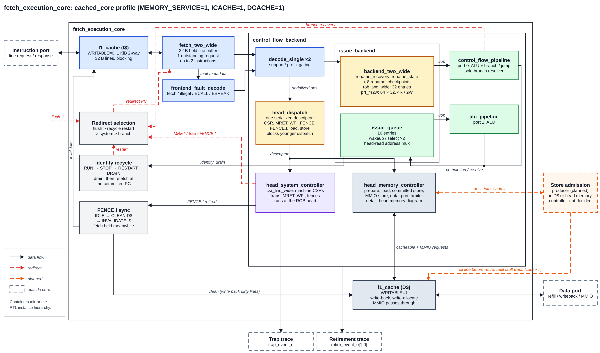
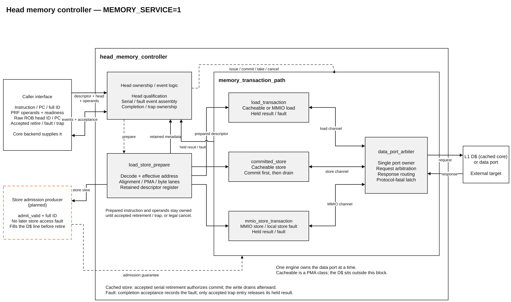
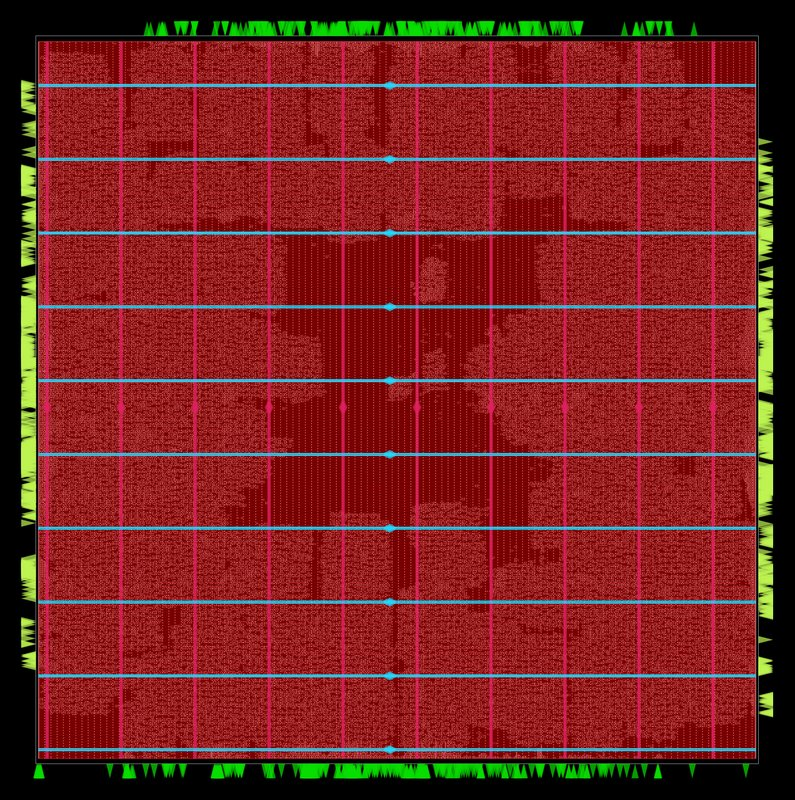

# Architecture

The diagrams show module hierarchy and interfaces, not clock-cycle stages. The
connected-core view is the full cached core
([`cached_core`](../config/cached_core.json) profile: memory on, both L1
caches). Orange dashed blocks are planned, not built.

## Connected core



- Fetch ([`fetch_two_wide.sv`](../rtl/frontend/fetch_two_wide.sv)) holds one
  32-byte line and offers up to two instructions. It predicts PC+4 and a taken
  branch resolves on port 0. A redirect drops the buffered line.
- Rename and allocation take up to two instructions. A lane-0 branch or fault,
  a full resource or a system instruction can shorten the group.
- The issue queue wakes ops as operands arrive. Port 0 runs ALU and branch,
  port 1 runs ALU.
- The PRF has 64 tags and p0 is always zero. A ROB entry is a 5-bit slot plus
  an 8-bit generation.
- Faults (fetch, illegal, ECALL, EBREAK) ride through the ROB as resultless
  entries. The trap is taken when the entry reaches the head.
- CSR, MRET, WFI, fences, loads and stores get a ROB entry alone, skip the
  issue queue and wait in `head_dispatch` until they reach the ROB head.
- When ROB generations run out, the identity-recycle logic drains the core and
  refetches from the last committed PC.

If redirects collide, external flush beats a recycle restart, which beats
system redirect, which beats branch recovery. In builds with memory off
(`system_core`), loads, stores and fences stall allocation until a redirect
clears them.

## Head memory subsystem



With `MEMORY_SERVICE=1`, [`head_memory_controller`](../rtl/core/head_memory_controller.sv)
runs loads and stores only when they reach the ROB head with both operands ready.

- A load writes its destination at retirement.
- A cacheable store needs external admission, writes its bytes after retirement,
  and blocks the next memory op until the write drains. The core exposes the
  admission interface; the producer that drives it is not built yet.
- An MMIO store can't be undone, so external flush waits while one is in flight.
- One engine owns the data port at a time.

Details are in the [controller contract](../config/head_memory_controller.json).

## Caches

With `ICACHE=1` and `DCACHE=1` ([`cached_core`](../config/cached_core.json)
profile), [`fetch_execution_core`](../rtl/core/fetch_execution_core.sv) puts a
blocking [`l1_cache`](../rtl/memory/l1_cache.sv) on each port. Both are 1 KiB,
two-way LRU, with 32-byte lines; this is the only geometry the storage provider
accepts ([`cache.json`](../config/cache.json)).

- The I$ is read-only and sits between fetch and the instruction port.
- The D$ is write-back and write-allocate, between the data-port arbiter and
  the data port. MMIO passes through unchanged.
- A miss blocks that cache until the refill returns. There is no hit-under-miss,
  prefetch or coherence beyond FENCE.I.

## Fences

FENCE waits for older data accesses, including store write responses. FENCE.I
waits the same way. Once it retires, fetch holds while the D$ writes back every
dirty line and the I$ invalidates, then fetch restarts at PC+4.

## Physical design so far



OpenROAD render of the I$ + D$ storage (1 KiB + 1 KiB, two-way) after
LibreLane placement and global routing on SKY130 HD: a 1500 × 1511 µm die,
97,642 cells and 19,164 flip-flops. Red is the standard-cell area, the cyan and
magenta lines are the power straps, and the green triangles are pins. It passed
setup and hold at all nine PVT corners under a 40 ns experiment constraint,
with 21.2 ns worst setup slack and 35.9 ps worst hold slack.

This is the storage only, not the core, and the 40 ns is not a processor clock.
Detailed routing, extraction, DRC/LVS and a full-core run are still to do.

## Diagram source

[`core.drawio`](diagrams/core.drawio): page 1 is `rtl-overview.png`, page 2
`head-memory-controller.png` and page 3 `simplified-architecture.png` (README
overview). All three show the L1 caches and the planned store admission
producer. To re-export all pages at 2× scale:

```sh
docker run --rm -v "$PWD/docs/diagrams:/data" \
  rlespinasse/drawio-export@sha256:2c133c2bbb42ba97fb3c8aca83fd62be3927fef8c7caeba2673d4092b7f6c578 \
  --format png --scale 2 --border 10
```

It writes `export/core-<page>.png`; copy each over its file above.
